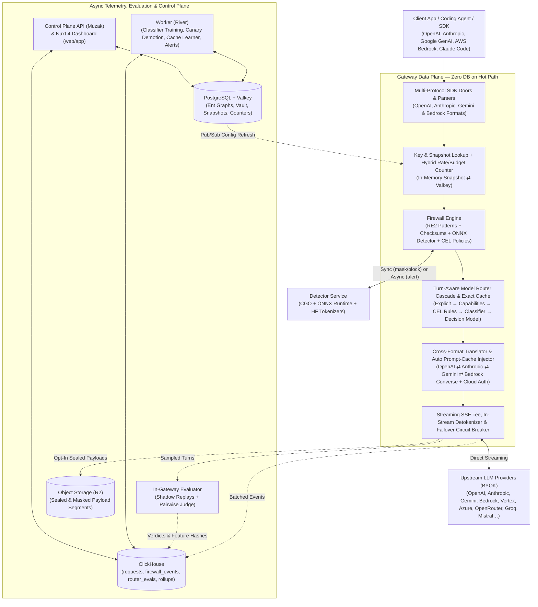

# Promptdam

**Cut the LLM bill. Block the leaks.**

[](project.md)
[](go.mod)
[](#architecture)

Promptdam is an OpenAI-, Anthropic-, Gemini-, and Bedrock-compatible AI gateway that sits in front of model providers using **your own provider keys (BYOK)**. Change one line (`base_url`), and Promptdam routes every request to the cheapest model that meets your quality bar, fixes broken prompt caches, proves every saved dollar in a per-request ledger, and stops secrets and personal data from leaving your company.

Your providers bill you directly as before; Promptdam never resells tokens or marks up usage.

> [!IMPORTANT]
> **Active Development Notice**
>
> Promptdam is currently in **active pre-beta development** inside the [Keel](../../../README.md) workspace.
> - **Completed & Verified:** The data-plane gateway (`server/cmd/gateway`), control-plane API (`server/cmd/api`), background worker (`server/cmd/worker`), cross-format protocol translation, quality-guarded model routers, learned prompt caching, savings ledger, billing/metering integration, and hybrid pattern + ONNX firewall detector (`detector/`).
> - **In Progress:** Multilingual PII/secret model training (`research/pii/`), the Nuxt 4 client dashboard and landing site (`web/`), and production VPS soak testing.
> - **Provisional Branding:** The name *Promptdam* (`pd_sk_…`, `X-Promptdam-*`) is provisional and isolated in [`server/brand`](server/brand/brand.go). The repository will move to its own organization once the final brand is locked.

---

## Table of Contents

- [Why Promptdam?](#why-promptdam)
- [Architecture](#architecture)
- [Core Capabilities](#core-capabilities)
  - [1. Quality-Guarded Model Routing](#1-quality-guarded-model-routing)
  - [2. Learned Prompt Caching & Cache Doctor](#2-learned-prompt-caching--cache-doctor)
  - [3. Hybrid AI Firewall (Patterns + ONNX Model)](#3-hybrid-ai-firewall-patterns--onnx-model)
  - [4. Coding Agents (Claude Code)](#4-coding-agents-claude-code)
  - [5. Verifiable Savings Ledger & Budgets](#5-verifiable-savings-ledger--budgets)
- [Performance & Overhead](#performance--overhead)
- [Repository Layout](#repository-layout)
- [Local Development & Testing](#local-development--testing)
- [Documentation & ADRs](#documentation--adrs)

---

## Why Promptdam?

Most engineering teams overspend on LLMs by 30–60% because every call hits the strongest model, prompt caches silently miss due to unstable prefixes (timestamps, unsorted JSON, tool churn), or routers switch models mid-conversation and destroy warm caches. Meanwhile, applications and coding agents routinely leak `.env` secrets, API keys, and customer PII to third-party providers.

| Capability | Typical Gateways & Routers | Promptdam |
|---|---|---|
| **Billing Model** | Token markup (5–8%) or credit resale | **100% BYOK.** Zero token markup; providers bill you directly |
| **Model Routing** | Static rules or generic "difficulty" scores | **Learned on your traffic**, gated by shadow evals & pairwise judges |
| **Conversation Awareness** | Routes request-by-request (breaks caches) | **Turn-aware & cache-aware:** holds warm tiers unless switching pays |
| **Prompt Caching** | Manual provider-specific markers | **Auto-injected breakpoints**, learned per-model profiles & **Cache Doctor** |
| **AI Firewall** | Enterprise add-on or regex-only | **Built-in:** Fast RE2 patterns + checksums + ~45-language ONNX detector |
| **Savings Proof** | Aggregate estimates | **Auditable per-request ledger** (`counterfactual` vs `actual`, by basis) |

---

## Architecture

Promptdam separates the ultra-low-latency **Gateway Data Plane** from the **Control Plane API**, **River Job Worker**, and **ONNX Detector Service**. Nothing on the hot path makes synchronous database queries.



---

## Core Capabilities

### 1. Quality-Guarded Model Routing

Instead of guessing prompt difficulty from length or generic vendor scores, Promptdam lets you define a **Router** with up to 8 tiers in plain words (from cheapest to strongest, including reasoning effort levels) and learns the exact boundaries from your traffic:

1. **The Cascade (Cheapest Check First):**
   - **Explicit:** Developer specifies `"model": "auto:expert"` or `X-Promptdam-Tier`.
   - **Capabilities Filter:** Skips tiers whose models lack required tools, vision/PDF support, JSON schema output, or context window size (`0 µs` network cost).
   - **CEL Rules:** Deterministic conditions over `request.*` (tokens, tools, family, tags, user).
   - **In-Gateway Classifier:** Sparse logistic regression over hashed prompt features running in **microseconds** inside the gateway. Picks the cheapest tier whose calibrated probability clears your quality floor.
   - **Decision Model (Opt-In):** When the classifier is unsure, queries a fast decision model (OpenRouter Decisions API or a low-effort chat model) with an auto-calibrated p99 timeout and 10-minute cache.
   - **Safe Default:** Falls back to the strongest tier—mistakes lean upward, never risking answer quality.
2. **Turn & Cache Awareness:** Agent tool loops stay on the tier chosen for the human message (`wire.Turn`). When a new turn could move to a cheaper tier, Promptdam calculates whether the savings over the next turns outweigh the cost of rebuilding a warm prompt cache (`tier_source = held`).
3. **Shadow Mode, Activation Gate & Canary:** New routers start in **shadow mode**, replaying a sample of turns across tiers and grading them with deterministic checks + a bias-checked pairwise LLM judge. A router can only be activated once every tier's 95% Wilson confidence interval clears your quality floor (default 95%). In production, an hourly **canary** automatically demotes any tier whose quality drifts.

Full deep dive and live multi-user benchmarks: [`docs/how-promptdam-decides.md`](docs/how-promptdam-decides.md).

### 2. Learned Prompt Caching & Cache Doctor

- **Auto Prompt Caching:** Automatically injects Anthropic `cache_control` breakpoints on tools, system instructions, and conversation tails (respecting minimum token prefixes and 4-breakpoint limits), attaches OpenAI `prompt_cache_key`s, and learns whether 5-minute or 1-hour TTLs pay off per prompt family.
- **Cross-Project Learned Profiles:** Thousands of models ship across providers and marketplaces like OpenRouter with inconsistent caching behavior. Promptdam pools anonymous cache-hit statistics hourly to learn which strategy (`markers`, `auto`, `markers+session`) works per model and automatically avoids backends that fail to cache.
- **Cache Doctor:** Analyzes prefix divergence across prompt families (timestamps, UUIDs, changing numbers, unsorted tool definitions, parallel cold writes) without storing prompt text, ranking issues by **projected monthly dollar savings** with actionable fix snippets.

### 3. Hybrid AI Firewall (Patterns + ONNX Model)

Every request is scanned **before** routing, caching, or upstream transmission:

- **Exact Pattern Engine (`core/pkg/redact`):** High-speed RE2 scanners and issuer checksum validators for API keys, cloud credentials, `.env` assignments, private keys, payment cards, IBANs, machine-readable passports, and **national ID numbers across 33 countries**. Source code that *reads* a secret (`os.Getenv("KEY")`, `cfg.Token`) is distinguished from actual secret literals.
- **Multilingual ONNX Detector (`detector/`):** A standalone CGO + ONNX Runtime service that reads prose and tool results in **~45 languages** to catch person names, street addresses, dates of birth, GDPR Article 9/10 special categories (health, religion, biometrics, politics), and unformatted credentials.
- **Granular Actions & Reversible Tokenization:**
  - `block`: Rejects the request with `400 firewall_blocked` before any data leaves.
  - `redact`: Masks values in place (`[REDACTED:email]`).
  - `tokenize`: Replaces PII with deterministic, conversation-keyed placeholders (`⟦person_k3x9q2mb⟧`) so provider prompt caches and signed thinking blocks stay intact, then **restores the real values in-stream** (including inside tool-call JSON arguments).
  - `alert`: Logs the finding and scans asynchronously off the hot path with zero added latency.
- **CEL Firewall Policies:** Enforce organization-wide rules such as data residency (`target.provider in ["deepseek"] && org.region == "eu" -> block`) or route sensitive prompts to dedicated private cloud endpoints (`route_to`).

Full details: [`docs/firewall-model.md`](docs/firewall-model.md).

### 4. Coding Agents (Claude Code)

Claude Code and other base-URL-configurable coding agents work natively through Promptdam. Tested end-to-end with the real `claude` CLI (`task demo:claudecode`): **identical token counts and costs** to calling Anthropic directly, **~0–2 ms added before the first byte**, and 89% cache read rates.

> [!WARNING]
> **Know the Firewall's Limits with Coding Agents**
>
> When a coding agent reads a file containing a secret, that secret enters the conversation history and is re-sent on every subsequent turn in the session:
> - **`block` (default):** Refuses the turn that read the secret and **every later call in that session** until `/rewind` or `/clear`.
> - **`redact` (recommended for agents):** Keeps the secret from reaching the provider while letting the session continue, though the agent cannot edit the exact line containing `[REDACTED:…]`.
> - **Secrets are never tokenized:** By design, Promptdam refuses to tokenize secrets so a prompt injection cannot trick an agent into writing the restored secret to disk and exfiltrating it.
>
> Give coding agents a dedicated project with secrets set to `redact`, and deny `.env` reads in `.claude/settings.json`. See [`docs/coding-agents.md`](docs/coding-agents.md) for the complete guide.

### 5. Verifiable Savings Ledger & Budgets

- **Per-Request Savings Ledger:** Every logged call records `cost_micros`, `counterfactual_micros` (what the requested model would have cost at list price without caching), `savings_micros`, `savings_reason` (`routing`, `response_cache`, `prompt_cache`, `fallback`), and `savings_basis` (`provider`, `cache`, `replays`, `estimate`). Evaluation and decision-model costs are deducted automatically.
- **Microsecond Budgets & Alert Rules:** Enforce daily or monthly soft (alert) and hard (429 `budget_exceeded`) budgets per organization, project, API key, developer, or route using hybrid local-bucket + Valkey counters (~0.4 µs per check).
- **Privacy by Default & Payload-Free Mode:** Promptdam logs only metadata by default. Opt-in payload capture masks all secrets and PII, compresses, and seals payloads with your organization's vault key in R2 segments. Business plans include an organization-wide **Payload-Free Mode** switch that guarantees zero content storage.

---

## Performance & Overhead

Promptdam's data plane is written in Go with zero synchronous database calls on the request path, pooled buffers, and compiled in-memory config snapshots refreshed via Valkey pub/sub.

| Workload (Measured on Apple M1 Pro) | Median (p50) Overhead | p99 Overhead | Notes |
|---|---|---|---|
| **Standard Chat / Messages (Streamed)** | **+1.3 – 1.4 ms** | **+5.4 – 6.1 ms** | Full path: auth, Valkey counters, firewall, router, ClickHouse log |
| **Standard Chat (Non-Streamed)** | **+0.4 ms** | **+1.3 ms** | Against a 40 ms p99 gate (`task bench`) |
| **Coding Agent Turn (600 KB body)** | **+17.7 ms** | **+32.7 ms** | 60 tool results scanned by the firewall |
| **1,000 req/s Open-Loop Load (`bench:load`)** | **+0.6 – 1.7 ms** | **+30.6 – 37.2 ms** | 120,000 calls on 1 replica, 0 errors, 0 dropped logs, <280 MiB heap |

Full methodology, load scenarios, and benchmarks: [`docs/performance.md`](docs/performance.md).

---

## Repository Layout

Promptdam lives inside the [Keel](../../../README.md) workspace at `products/promptdam/promptdam` and shares foundational packages (`pkg/vault`, `pkg/redact`, `pkg/policy`, `pkg/llm`, `pkg/billing`, `@keel/app-kit`) from `keel/core`.

| Path | Description |
|---|---|
| [`server/`](server/) | Go backend (`github.com/hasan-muzak/promptdam`): `cmd/{api,gateway,worker,migrate}`, domain features (`server/features/`), Ent graph, and Postgres/ClickHouse migrations |
| [`server/brand/`](server/brand/brand.go) | Single source of truth for outward-facing product names, key prefixes (`pd`), domain, and `X-Promptdam-*` wire headers |
| [`detector/`](detector/) | Standalone firewall ML detector service (own Go module, CGO, ONNX Runtime, HuggingFace tokenizers) |
| [`bench/`](bench/) | CI latency overhead gate (`overhead_test.go`), open-loop load generator (`cmd/load`, `load.sh`), and fake multi-format LLM upstream (`fakeupstream/`) |
| [`examples/`](examples/) | Runnable quickstarts for `curl`, Python (`openai`, `anthropic`, `google-genai`, `boto3`), and local seeding |
| [`research/`](research/) | PII detector bake-off (`research/pii/`), multilingual training pipeline, and coding-agent proxy studies (`research/caveman/`) |
| [`deploy/`](deploy/) | Distroless multi-command `Dockerfile`, `detector.Dockerfile`, `Caddyfile`, and cosign keyless verification docs |
| [`docs/`](docs/) | Deep-dive technical documentation and Architecture Decision Records (`docs/adr/`) |
| [`project.md`](project.md) | Master product roadmap, architecture specification, and phase checklist |
| [`plans.md`](plans.md) / [`pages.md`](pages.md) | Plan catalog specification (`Free`, `Pro`, `Team`, `Business`) and dashboard UI specification (`web/` to come) |

---

## Local Development & Testing

### Prerequisites

- **Go 1.27+** (pinned in `go.mod`)
- **Docker & Docker Compose** (runs Promptdam's isolated local stack on ports `2xxxx`)
- **[Task](https://taskfile.dev)** (`brew install go-task`)

### 1. Start the Local Stack & Services

Run these commands from `products/promptdam/promptdam/` (or prefix with `task promptdam:<cmd>` from the `keel` workspace root):

```sh
# 1. Create .env from .env.example and start Postgres, Valkey, ClickHouse, S3, Mailpit & stripe-mock
task setup && task dev:stack

# 2. Apply Postgres (Ent/Goose) and ClickHouse migrations
task migrate

# 3. Start the API (:8281), Gateway (:8282), and Worker (:8291)
task dev:api &
task dev:gateway &
task dev:worker &
```

### 2. Try the Gateway Locally Against a Fake Provider

You can test the entire pipeline locally without spending a cent on real LLM APIs:

```sh
# Start the fake OpenAI/Anthropic provider on :8299
task dev:fake &

# Seed a local organization, project, provider, and gateway key (pd_sk_test_…)
task dev:seed

# Run the curl or Python examples against localhost:8282
./examples/curl.sh
```

### 3. Run Tests, Benchmarks & Live Demos

```sh
# Run the full Go test suite (with race detector) against the local stack
task test

# Run the p99 latency overhead gate and microbenchmarks
task bench

# Build and test the ONNX firewall detector service
task detector:lib && task detector:test

# End-to-end live demos (require real provider keys in .env; capped at $0.10–$3.00)
task demo:customs      # Multi-turn customs broker router & ledger check
task demo:traffic      # 10 concurrent users over 21 minutes with cache & routing ledger
task demo:claudecode   # Real Claude Code CLI session direct vs. through Promptdam
task demo:clouds       # AWS Bedrock, Google Vertex AI & Azure AI Foundry live check
task demo:doors        # Google GenAI and AWS Bedrock Runtime SDKs through /gemini & /bedrock
```

---

## Documentation & ADRs

- **Guides & Measurements**
  - [How Promptdam Decides Which AI Model Answers](docs/how-promptdam-decides.md) — Plain-language guide to tiers, the cascade, turn awareness, and live routing benchmarks.
  - [The Firewall's Model](docs/firewall-model.md) — How exact patterns and the ONNX detector work together across ~45 languages.
  - [Coding Agents Through Promptdam](docs/coding-agents.md) — Claude Code setup, benchmark numbers, and why secrets are redacted rather than tokenized.
  - [Performance & Load Testing](docs/performance.md) — Latency overhead budgets, 1,000 req/s load tests, and memory profiling.
  - [Client-Side Fallback Guide](docs/fallback.md) — How and when an application should bypass the gateway if it is unreachable.
  - [Plans & Pricing Specification](plans.md) — Detailed breakdown of Free, Pro, Team, and Business plans and downgrade guarantees.
  - [Deployment & Image Verification](deploy/README.md) — Distroless builds, cosign keyless signatures, and SPDX SBOM verification.
- **Architecture Decision Records (`docs/adr/`)**
  - [ADR 0001: Model Routers](docs/adr/0001-model-routers.md) — Customer-described tiers, the cascade, pairwise judging, and calibrated classifiers.
  - [ADR 0002: Turns, Effort & Switch Cost](docs/adr/0002-turns-effort-switch-cost.md) — Grouping agent loops into turns, reasoning effort tiers, and cache-aware switching.
  - [ADR 0003: Learned Prompt Caching](docs/adr/0003-learned-caching.md) — Pooling cache hit rates per model and backend without per-model hardcoding.
  - [ADR 0004: Cloud Providers](docs/adr/0004-cloud-providers.md) — Native AWS Bedrock (Mantle & Converse), Google Vertex AI, and Azure AI Foundry integration.
  - [ADR 0005: SDK Doors](docs/adr/0005-doors.md) — Speaking native Gemini (`/gemini`) and Bedrock Runtime (`/bedrock`) APIs at the edge.

