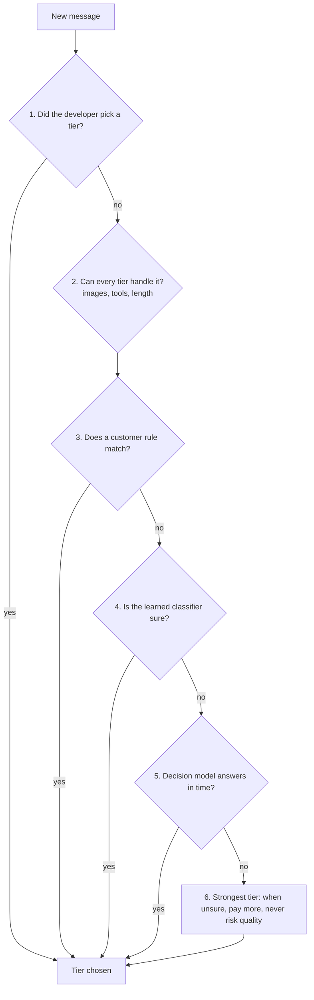

# How Promptdam decides which AI model answers

*A plain-language guide to Promptdam's routing architecture, October 2026.*

## The problem

Many companies building on AI send every request to one model, usually the strongest and most expensive one they
trust. Most of those requests don't need it. "List Turkey's company types" and "compare the tax and liability of three
legal forms for this client" go to the same model at the same price.

Picking a cheaper model per request sounds simple. In practice, four things make it hard:

1. **A wrong pick hurts quality.** A hard question sent to a small model returns a worse answer, and the customer's
   users notice.
2. **Deciding costs time and money.** Asking a second AI "how hard is this?" before every request adds delay and a
   bill of its own.
3. **Switching models mid-conversation is expensive.** Providers cache the conversation so they don't re-read it. Each
   model has its own cache, so a switch starts from zero. A careless router can spend more rebuilding caches than it
   saves on cheaper models.
4. **Savings claims are hard to trust.** Most tools report a single number with no way to check it.

Promptdam is a gateway: a customer changes one line (the address their app sends AI requests to) and keeps their own
provider keys. Routing is one of the things the gateway does on every request, and the rest of this page explains
how it decides.

## The customer describes the work; Promptdam learns the boundaries

A customer sets up a **router**: a short list of **tiers**, cheapest first, each described in plain words.

| Tier | Model | What it is for (the customer's words) |
|---|---|---|
| fast | Claude Haiku 5.5, thinking little | definitions, single facts, rewording, short emails, summaries |
| expert | Claude Sonnet 5.5 | legal analysis, tax trade-offs, calculations, checking documents |

The app then asks for the model `"advisor"` (the router's name) instead of a specific model. Any provider works in
any tier: Promptdam translates between OpenAI's and Anthropic's API formats, so a tier can be a Claude model while the
next is a GPT or Gemini model.

A tier can also be the same model at a lower **reasoning effort**. Often the cheapest tier that still gives good
answers is the strong model thinking less, not a different model.

## Each turn goes through a cascade, cheapest check first

For every new message a person sends, Promptdam runs a cascade: a series of checks that stops at the first one that
can decide. The cheap checks run first. The one expensive check (asking another AI) runs only when everything before
it is unsure.

| Step | What it is | Time it adds |
|---|---|---|
| 1. Explicit | The developer names a tier (`"advisor:expert"`). Developers often know. | none |
| 2. Requirements | Tiers whose model can't take the request (images, tools, a long document) are skipped upward. A filter, not a guess. | microseconds |
| 3. Rules | The customer's own conditions, e.g. "first message of a conversation goes to fast". | microseconds |
| 4. Classifier | A small model trained on the customer's own traffic (see below) estimates, per cheaper tier, the chance its answer is as good as the strong tier's. It picks the cheapest tier that is clearly good enough. Runs inside the gateway, with no network call. | microseconds |
| 5. Decision model | Only when the classifier is unsure or not trained yet: a small, cheap AI reads the tier descriptions and the message, and names a tier. | 0.3 to 0.6 seconds for a dedicated decision model, about 1 second for a chat model like Claude Haiku |
| 6. Safe default | Nothing decided with confidence: the strongest tier. | none |

Two principles run through every step:

- **Safety is asymmetric.** A hard request on a weak model costs quality; an easy request on a strong model only
  costs money. So every step leans toward the stronger tier when unsure, failures fall back upward, and length alone
  never moves a request to a weaker model.
- **Difficulty isn't guessed from surface features.** A two-line question ("is this clause enforceable?") can need the
  strongest model, while fifty paragraphs with "count the dates" may not. The boundaries come from judged answers on
  the customer's traffic.

### The decision model: a triage nurse, not a doctor

The tiers' models are the doctors: they write the answers. The decision model is the triage nurse: it treats no one,
it only decides which doctor sees the patient. Promptdam can use two kinds:

- **A dedicated decision model** (on OpenRouter: Jev, Mercury Decide, GPT-6 Luna Decisions and others). It writes no
  text; it answers one question, "which tier?", with a probability for each tier, and it is billed for what it reads.
  Promptdam serves the cheapest tier that is at least 80% likely to be enough, so a model torn between two tiers
  leads to the stronger one.
- **A chat model** (Claude Haiku, a small GPT), asked to name a tier in words.

In live tests the dedicated decision models answered in 0.3 to 0.6 seconds at the median for $0.0005 to $0.003 per 50
questions, against 0.9 seconds and $0.004 for Claude Haiku. A decision model can't be a tier or the judge: it writes
no answers, and Promptdam refuses a router that tries.

### The decision model waits only as long as it needs to

The decision model is the one step that costs time and money, so Promptdam watches it closely:

- **An automatic time limit.** Promptdam measures how long the customer's decision model takes and waits a quarter
  longer than its slow answers (its 99th percentile, over its latest 128 answers), never more than 3 seconds. If an
  answer is late, the request goes to the strongest tier rather than waiting. A limit that turns out too short grows
  by itself, and a model that speeds up gets a shorter wait.
- **Answers are reused.** The same question within 10 minutes reuses the earlier answer at no cost.
- **Nothing fails silently.** Every question is logged as answered, reused, late, failed or unreadable, with its wait,
  and the router's report shows the totals. Measured live with Claude Haiku 5.5 as the decision model, on ten users'
  traffic: 50 of 50 questions answered in time, median wait 0.93 seconds, 99th percentile 1.44 seconds, $0.004 in
  all.
- **It fades out.** As the classifier learns, fewer messages reach the decision model. The target, to be measured in
  beta, is under 10% of messages once the classifier is trained.

## Conversations, not single requests

AI agents (coding assistants, support bots with tools) send one human message and then many follow-up requests: call a
tool, read the result, call another tool. A naive router would place each of these separately and could switch models
in the middle of one task.

Promptdam groups requests into **turns**. A turn starts with a human message and includes every tool call that
follows. The whole turn stays on one tier, on every gateway server, so the provider's cache and the model's own
reasoning carry through the task. The follow-up requests may still move up (a tool result too long for the small
model), never down, and the decision model is never asked in the middle of a turn.

## Switching must pay for itself

When a new turn would move a conversation to a cheaper model, Promptdam first checks the price of the switch. It
compares what the next few turns (up to four) would save on the cheaper model against the one-time cost of rebuilding
the conversation's cache there. If the switch doesn't pay, the conversation stays where it is, and the request log
says so (`held`). Moves to a stronger tier are never held back.

## Caching that learns every model

Providers keep the start of a conversation (its instructions and earlier messages) in a cache and charge about a
tenth of the normal price to read it again. Each provider caches its own way. Anthropic caches only what a request
marks. OpenAI caches on its own. A model served through a marketplace like OpenRouter may cache marked requests on
one of its backends and nothing on another. Thousands of models exist and new ones ship every day, so Promptdam
keeps no list of them. It learns:

- **Every call records what it should have read from the cache and what it did read.** A call should read when its
  conversation's previous call was recent and went to the same model on the same backend.
- **Every hour, the counts from all customers are pooled into a profile per model:** whether to mark the request, and
  which backends never cache it. Only counts are pooled, never what anyone wrote, and a customer sees a pooled figure
  only when at least three customers contributed.
- **While the evidence is thin, one conversation in ten tries the other way.** The other way takes over only once both
  have 300 data points and it is at least 10% cheaper, so the choice doesn't flip on noise.
- **Mistakes are cheap.** A provider that refuses the markers gets the request again without them at once, and the
  markers go off for that model everywhere within seconds.

A model released today starts with a guess from its price list (a listed price for writing the cache means it caches
what a request marks), then its own traffic corrects it.

## Quality is proven before any money is saved

A new router starts in **shadow mode**: it decides, but every request is still served by the strong tier, so users
see no change.

1. **Judging.** On a sample of real requests (10% in shadow mode, 2% once active), Promptdam replays the request on the
   cheaper tiers and compares the answers with the strong tier's. Exact checks come first (valid JSON, the right tool
   called). Otherwise a judge model compares the two answers in random order. A judge that changes its verdict on more
   than 10% of answers when their order is swapped is asked both ways every time, until that falls under 5%.
2. **Learning.** Every verdict trains the classifier: "for requests like this, the fast tier held up". It learns
   splits within one task, like "count, list, extract" versus "why, prove, is it legal". A tier needs 200 judged
   samples before the classifier sends it anything.
3. **Activation gate.** A router can serve real traffic only when every cheaper tier it would use meets the
   customer's quality floor (default: 95% of answers as good as the strong tier's), at the cautious end of a 95%
   confidence interval, on at least 50 judged requests.
4. **Canary.** Judging continues after activation. A tier whose quality drifts below the floor is demoted
   automatically, its requests go one tier up, and the customer is alerted.

All of this runs on the customer's own provider keys, within an evaluation budget they set, and requests are never
stored for it: they stay in the gateway's memory until judged.

## Every saving is priced and explained

Each request in the log carries its own ledger line:

- **What it cost**, from the usage the provider reported, at list prices.
- **What it would have cost without Promptdam**: the router's strongest tier, at list price, with no caching.
- **Why it differs**: routing, the provider's prompt cache, or Promptdam's response cache.
- **How it is known**: the provider's own numbers, measured replays, or an estimate, labelled as such.
- **What deciding cost**: the decision model's bill is subtracted from the saving, so the saving shown is net.

## A real example: ten users, half an hour

To test the architecture end to end, we ran a realistic customer through it on real Claude models: **CustomsPilot**,
an assistant for Turkish customs brokers and accountants (a fictional product, from a real customer idea). It has
long instructions, two tools (a tariff search and a rates lookup) and a router with two tiers: Claude Haiku 5.5 at low
effort and Claude Sonnet 5.5.

Ten users chatted with it at the same time for 21 minutes: brokers, accountants, an importer, a freight forwarder and
an online seller. They sent 50 messages (57 requests, because tool questions take extra round trips), each answered
before the next, with the whole history sent each time. Like real people, they paused to read and type (35 seconds to
3.5 minutes), and seven took a break longer than the provider's 5-minute cache (5.5 to 11 minutes).

| User | What they asked about | Messages | To the cheaper model | Saved |
|---|---|---|---|---|
| Can, broker's assistant | definitions of customs terms | 6 | 6 | 97% |
| Mehmet, customs broker | classifying Bluetooth headphones | 6 | 3 | 65% |
| Selin, customs broker | a toy shipment's mismatched papers | 5 | 2 | 64% |
| Elif, accountant | booking an import in USD | 5 | 3 | 62% |
| Hakan, freight forwarder | Incoterms and customs value | 4 | 2 | 58% |
| Ali, online seller | a first commercial import | 5 | 1 | 56% |
| Burak, exporter | inward processing, VAT refunds | 4 | 2 | 55% |
| Ayse, accountant and broker | the legal form for a new importer | 6 | 3 | 51% |
| Zeynep, importer | the cost of importing a machine | 5 | 1 | 45% |
| Deniz, accountant | a penalty for undervaluation | 4 | 1 | 33% |
| **All** | | **50** | **24** | **59%** |

| | Cost |
|---|---|
| With Promptdam (the decision model's $0.004 included) | $0.41 |
| The same traffic on Claude Sonnet 5.5 without caching | $1.00 |
| **Saved** | **$0.59 (59%)**: $0.40 by routing, $0.19 by caching |

What it shows:

- **The mix of questions decides the routing saving.** A user asking for definitions saved 97%; one asking about
  penalties, 33%, because nearly every question needed the stronger model.
- **Users keep each other's cache warm.** The product's instructions (about 3,000 tokens) are the same for everyone,
  so after one user's request cached them, every other user read them at the cheap cached price. After a 9-minute
  break, a user's next message still read those instructions from the cache and rebuilt only their own history.
- **Long breaks cost a little, and a longer cache wouldn't have paid here.** The seven messages after a break rebuilt
  their history. Estimated on the same requests, the provider's one-hour cache would have cost $0.43 instead of
  $0.41: it charges more for every cache write, and only seven messages would have benefited. Promptdam's cache
  lifetime learner makes this same comparison on each project's traffic and switches to the one-hour cache only
  where returns within the hour outweigh that premium.
- **The decision model was always in time:** 50 of 50 questions answered, median wait 0.93 seconds, 99th
  percentile 1.44 seconds, $0.004 in all.
- **The answers held up on spot checks.** The calculations were right to the lira (a machine import's VAT of
  TRY 1,144,192; an accounting entry of TRY 2,234,600), and the cheaper model's definitions, emails, summaries and
  checklists read well.

Honest limits:

- Ten users for 21 minutes is a realistic sample, not a forecast. Another product's mix of easy and hard questions
  would give another number.
- "Without Promptdam" means no prompt caching; a careful team could add caching by hand.
- The routing saving assumes Sonnet would have written answers as long as Haiku's. Promptdam replaces that estimate
  with a measurement once judged replays exist.
- The router was switched on directly. A real customer would run shadow mode first, and the quality gate above would
  decide.
- An earlier test found both models making the same legal error, on a point the product's instructions didn't
  cover. With that point added to the instructions, as a real customer would do, the cheaper model got it right.

Building these examples also found real problems, all fixed before this page was written. The decision model had
been calling current Claude models with a setting they reject, so routers silently used their strongest tier. The
original 150 ms time limit was too short for a model like Claude Haiku, which needs about a second. And requests
moved to a newer model kept settings that model refuses. Running realistic traffic through the product is part of
how it is built.

## The same traffic across vendors, against Jev Router

We ran the same ten users again on OpenRouter, with three vendors' models as tiers: DeepSeek V4.1 Flash for easy work,
Gemini 3.8 Flash for medium, OpenAI's GPT-6.1 Sol for hard. We ran it three times, once per decision model, and a
fourth time sent straight to TypeSafe's Jev Router, OpenRouter's own router, with no Promptdam router in front of it.

| Run | Cost for the 50 messages | Messages not on GPT-6.1 Sol | Decision model: in time, median wait, cost |
|---|---|---|---|
| Promptdam, Mercury Decide deciding | **$0.198** | 25 | 49 of 50, 0.58 s, $0.0005 |
| Promptdam, GPT-6 Luna Decisions deciding | $0.200 | 19 | 50 of 50, 0.35 s, $0.0026 |
| Promptdam, Jev 1.13 deciding | $0.219 | 20 | 49 of 50, 0.33 s, $0.0015 |
| Jev Router alone | $0.263 | 46 | (its own) |

Everything on GPT-6.1 Sol without caching would have cost $0.55 to $0.59 for the Promptdam runs' conversations, so
Promptdam saved 61% to 67%. What the runs show:

- **All three decision models sent the hard work to the strong model**: every penalty question, every calculation,
  the document check, every classification. Emails, summaries, to-do lists and definitions went to DeepSeek or
  Gemini. The three agreed on 25 messages needing GPT-6.1 Sol.
- **Jev Router moved far more traffic to cheaper models (46 of 50) yet cost 20% to 33% more.** The models it picked
  wrote longer answers and two of them read nothing from the cache, while Promptdam kept GPT-6.1 Sol's cache warm
  (87% to 88% of its input read from cache). A model that is cheap per token isn't always cheap per conversation.
- **Whether Jev Router's cheaper answers held up wasn't measured here.** At least 21 of the 25 messages our decision
  models sent to the strong model went to cheaper ones under Jev Router. Promptdam's judge can compare them; until it
  does, the comparison above is about cost, not quality.
- **A finding for us, since fixed:** Gemini read nothing from its cache through OpenRouter, so the medium tier cost
  about as much per message as the cached strong model. With caching that learns every model (above), the same 50
  messages had Gemini reading 42% of its input from cache, its input cost down 36%; the calls that still read
  nothing landed on a Google backend that never caches, which Promptdam learns to avoid once it has seen enough of
  them. The total ($0.219, 61% saved) moved with the length of the answers, which is most of the bill.

## What makes this hard to copy

- **It learns from each customer's own traffic**, judged against their own baseline, instead of a general difficulty
  score. The claim is "not worse than your current model, on your traffic", with the evidence attached.
- **It is conversation-aware.** Turns, cache-aware switching and reasoning effort as part of a tier target agent
  traffic, where most gateways route request by request.
- **Quality is gated and monitored**: shadow mode, an activation gate, automatic demotion. Not a one-time benchmark.
- **The ledger is checkable**: every request priced, every saving explained and labelled with how it is known.
- **Low overhead.** The gateway adds about 3 to 7 ms at the 99th percentile in benchmarks. Most requests are decided
  in microseconds; only an unsure classifier waits on a decision model.

## Where it stands

Built and tested end to end: the cascade, turns, cache-aware switching, effort tiers, evaluation, the classifier, the
activation gate and canary, the ledger, and the decision step with its automatic time limit, on chat models and on
dedicated decision models. Next: the dashboard that
shows all of this to customers, and design partners in production, where the numbers that matter (share of traffic
routed cheaper, quality held, money saved per month) get measured on real workloads.
